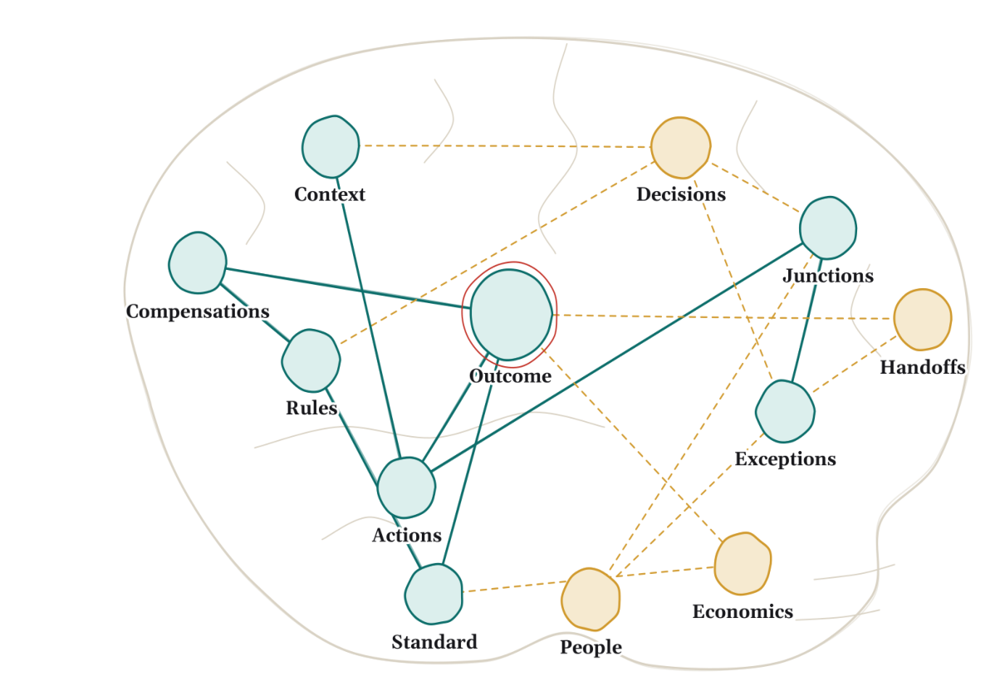

# The Work Loop Canvas



**A one-page instrument for getting AI into the core of a firm.** The Work Loop Canvas maps one *work loop* (one outcome, owned end to end) as twelve connected nodes. The **Work Loop Map** places every loop in the firm by value and readiness, and five **Scale Gates** say how far a loop may go today.

This repository contains, free and open:

| What | Where |
|---|---|
| **The Claude skill** that runs the method (Claude Code, Claude.ai, the API) | [`skills/the-work-loop-canvas/SKILL.md`](skills/the-work-loop-canvas/SKILL.md) |
| **The book** *The Work Loop Canvas: How Work Is Redesigned When the Executor Decides* (PDF) | [Latest release](../../releases/latest) |
| **The full lecture** (video) | [Latest release](../../releases/latest) |

By **Gennaro Cuofano**, [The Business Engineer](https://businessengineer.ai) and [FourWeekMBA](https://fourweekmba.com).

## Use the skill

**Claude Code**
```bash
git clone https://github.com/OWNER/work-loop-canvas.git
mkdir -p ~/.claude/skills
cp -r work-loop-canvas/skills/the-work-loop-canvas ~/.claude/skills/
```
Then ask Claude: *"Map our invoice-approval process with the Work Loop Canvas."*

**Claude.ai**: zip the `skills/the-work-loop-canvas` folder and upload it under Settings > Capabilities > Skills.

**API / Agent SDK**: load `SKILL.md` as a skill in your agent's skills directory.

## What the method covers

- The twelve nodes, filled in order: outcome, compensations, rules, context, actions, decisions, junctions, exceptions, handoffs, standard, people, economics.
- Why AI pilots stall: agents attached to the old process map automate the workaround.
- The Work Loop Map (value x readiness) and the five Scale Gates.
- How to run a 90-minute mapping session with a team.

## Licence

- The skill (`skills/`): MIT, see [LICENSE](LICENSE).
- The book and the lecture: Creative Commons Attribution 4.0 (CC BY 4.0), see [LICENSE-CONTENT](LICENSE-CONTENT). Share and adapt them with credit to Gennaro Cuofano / The Business Engineer.

## Go further

The Work Loop Canvas is volume II of **The Embedding Series**, the complete discipline for embedding AI into the core of a company, part of [The Business Engineer](https://businessengineer.ai).
